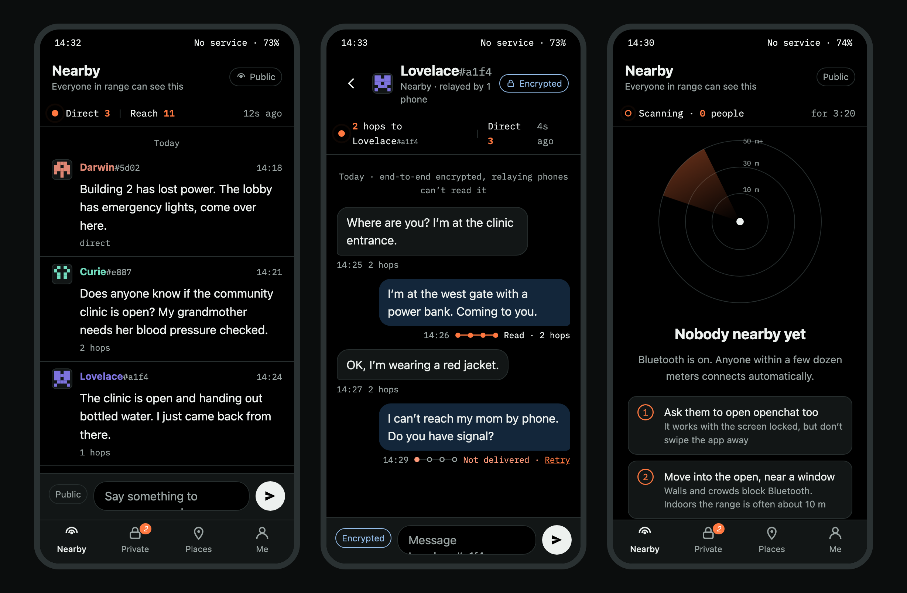
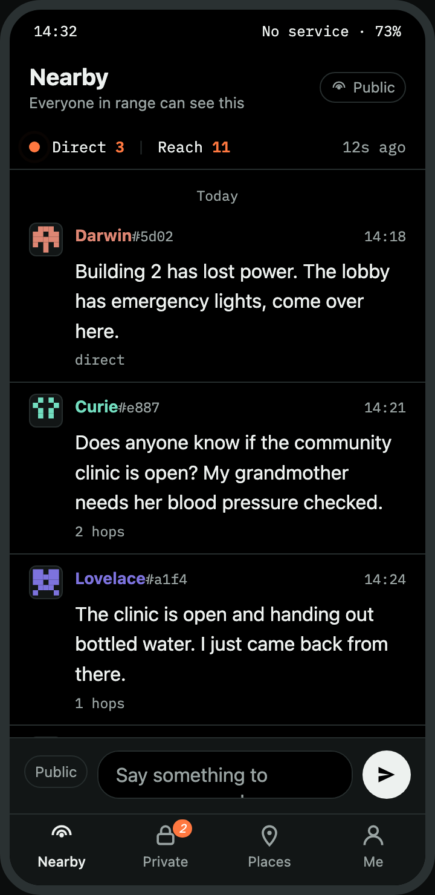
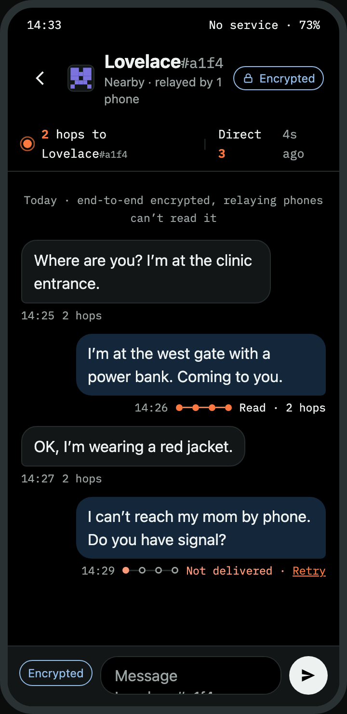
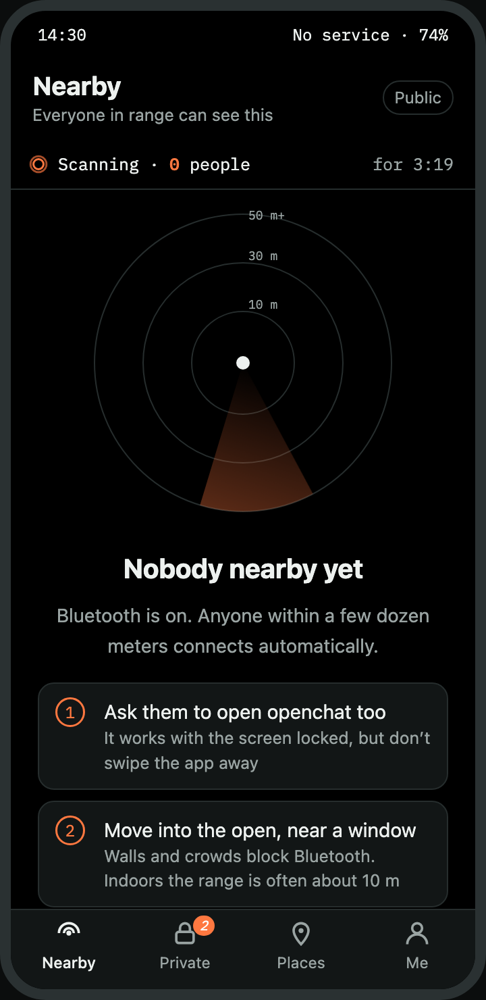

<div align="center">


# openchat

**Offline-first mesh messenger for blackouts, disasters and crowded places.**
Bluetooth LE mesh when there is no network. Nostr when there is.
No accounts, no phone numbers, no servers.

[](LICENSE)
[](https://github.com/wolfqing/openchat/releases)
[](https://github.com/wolfqing/openchat/actions/workflows/android.yml)
[](android/README.md)
[](android/)
[](docs/protocol-spec.md)
[](#status)

[**Download APK**](https://github.com/wolfqing/openchat/releases/latest) ·
[Protocol spec](docs/protocol-spec.md) ·
[Changelog](CHANGELOG.md) ·
[Roadmap](docs/roadmap.md) ·
[Contributing](CONTRIBUTING.md) ·
[Security](SECURITY.md) ·
[中文说明](README.zh-CN.md)



<sub>The three screens that define the app: Nearby with its signal band, a private chat with a delivery path on every message, and the radar you see when nobody is in range. Rendered from the design prototype; v0.7.0 implements them.</sub>

</div>

---

## Why this exists

When the network goes down, the phones in a building, a stadium or a
neighbourhood can still talk to each other over Bluetooth. Every phone
relays for every other phone, so a message hops from person to person
until it reaches someone it was meant for. That is what the
[bitchat](https://github.com/permissionlesstech/bitchat) protocol does,
and its protocol, code and whitepaper are in the public domain.

openchat is an **independent, MIT-licensed client for that same network**.
It speaks exactly bitchat's wire protocol and adds nothing to it. What it
changes is who the app is for and how it looks:

- **Built for people who have never seen IRC.** The people who install a
  mesh messenger during an outage are not terminal people. Three taps from
  install to first message, with the phone offline, is the bar.
- **The mesh is visible.** A signal band tells you how many phones you can
  reach. Every message says how many hops it crossed. Every private message
  shows a delivery path: sent, on its way, delivered, read. When nobody is
  in range you get a radar and three things to do, not an empty list.
- **Positioned for infrastructure failure, not politics.** Earthquakes,
  typhoons, carrier outages, festival and stadium congestion, hiking and
  sailing. It is not a censorship-circumvention tool and is not marketed
  as one.
- **Protocol compatible, always.** An openchat phone is a working relay for
  every bitchat phone and vice versa. Interop with upstream is a release
  gate, not a feature.

## Status

| | State |
|---|---|
| Android app | **v0.7.1 preview.** 175 unit tests, 9.1 MB APK, 18 languages. Changes in [CHANGELOG.md](CHANGELOG.md) |
| Interop with stock bitchat | **Not yet verified.** Implemented from the [spec](docs/protocol-spec.md), upstream test vectors and envelopes recorded from bitchat builds. Verification against a stock bitchat client is the next milestone |
| Security audit | **None.** Everything on the wire is upstream's; upstream had one audit (Cure53, 2025-11) with findings still open |
| Release signing | v0.6.0 and later are signed with a dedicated release key; its certificate fingerprint is in [SECURITY.md](SECURITY.md). Previews up to v0.5.0 were debug-signed and must be uninstalled first |
| iOS | Not started |

Do not rely on openchat where being identified has serious consequences.
The app says so on first launch. See [SECURITY.md](SECURITY.md).

## What it does

Every feature below is bitchat's wire format. The only things openchat
adds are local: how the mesh is drawn on screen.

### With no network at all

- **Nearby.** A signed public channel that everyone in Bluetooth range can
  read, relayed hop by hop. Long messages are fragmented and reassembled.
- **Private messages**, end-to-end encrypted with Noise XX, with delivered
  and read receipts. Relaying phones cannot read them.
- **Private groups** of up to 16 people. The creator signs the roster and a
  fresh key on every change; messages are sealed under the group key,
  signed by their author, and flooded like public ones, so only members can
  read them. Text only for now.
- **Notice board.** Pin a notice for 1, 3 or 7 days, mark it urgent, take it
  down later. Posts pass from phone to phone and through history sync, so
  someone who arrives two days later still reads them.
- **Store-and-forward.** Mail for someone out of range is sealed and handed
  to up to three nearby phones that carry it until they meet the recipient.
  Each phone publishes eight single-use prekeys, so carried mail is
  forward-secret: stealing the phone later does not unlock mail captured on
  the way.
- **History sync.** A late joiner receives the last 15 minutes of public
  messages, plus board posts and prekeys, from a neighbour.
- **Photos and voice notes**, public or private. **Live voice**: hold the
  mic and people hear you while you are still talking.
- **In-person verification** with a QR code and a Noise challenge, and
  **vouching**: people you verified tell your phone whom they verified, so
  their contacts get a grey tick on their card.
- `/ping` and `/trace` show the round trip, the hop count and an estimated
  path to someone on the mesh. IRC-style commands exist for people who want
  them: `/msg /who /block /fav /group /pay /drop /help` and friends.
- **Flood protection**, as bitchat: a sender gets five messages at once and
  then one a second; a repeated text three times and then once every two
  seconds. Excess is hidden, still relayed.

### When there is internet

- **Location channels** over Nostr, keyed by geohash, with one anonymous
  key per cell and a globe picker to choose the area: drag, pinch, tap.
  Same relays as bitchat, so the rooms are shared. Location notes fade
  after 24 hours.
- **Mesh bridge**, off by default. With it on, Nearby messages also travel
  through the relays for your neighbourhood cell (about 1.2 km) under an
  unlinkable per-cell key, so two Bluetooth islands in the same area hear
  each other. A bridging phone with internet also serves the phones around
  it that have none: their location-channel posts go out through it, and
  mail for someone out of reach is parked on relays as a sealed drop.
- **Private messages over Nostr** between mutual favorites, in bitchat's
  envelope format, when Bluetooth cannot reach them.
- **Tor by default, fail-closed.** Relay traffic goes through Tor; if Tor is
  down, nothing goes out in the clear. Location-channel messages carry a
  small proof of work so a busy sender gets past per-sender limits.
- `/pay` sends a Cashu ecash token; tokens in messages show as a card with
  amount, mint and memo and an "Open in wallet" button. The app never talks
  to a mint.

### Safety and everyday use

- **No account, no phone number, no email.** Keys are generated on first
  launch. The default nickname is `anon`; every name carries a `#xxxx`
  suffix derived from the key, so two people with the same name cannot be
  confused.
- **Triple-tap the logo** in the top-left corner to erase everything and
  start with a new identity. No confirmation, by design. The Me tab also
  has an "Erase everything" button with a confirmation for people who
  cannot tap three times quickly. The wipe zeroes the old keys, restarts
  Tor on fresh guards and discards anything still queued under the old
  identity.
- **Quiet by default.** Notifications say "New message" with no name,
  place or text unless you turn previews on; the lock screen stays quiet
  either way. Received photos appear as coarse blocks until tapped.
- **Share the app offline.** Send the APK to the phone next to you over
  Bluetooth or Quick Share. No app store needed, which matters when the
  app store is unreachable.
- Keeps relaying with the screen off. The radio follows a scan duty cycle
  so it sleeps two thirds of the time. Block people on the mesh and per
  location channel. @mentions. Screen-reader support.
- **18 languages**, including right-to-left Arabic and Persian. Machine
  drafted; native speakers welcome.

The full feature-to-file map and the test suites are in
[android/README.md](android/README.md).

## Screenshots

<table>
<tr>
<td align="center"><br><sub><b>Nearby.</b> Direct 3, reach 11. Every sender has an emblem drawn from their key; every message says how far it travelled.</sub></td>
<td align="center"><br><sub><b>Private.</b> Four dots per message: sent, on its way, delivered, read. A message that never arrives turns red with Retry.</sub></td>
<td align="center"><br><sub><b>Nobody nearby.</b> The most common state during an outage, so it gets a real screen: a radar and three things that help.</sub></td>
</tr>
</table>

<sub>Rendered from the clickable prototype in
[docs/design/ui-prototype.html](docs/design/ui-prototype.html). The design
rationale is in [docs/design/ui-direction.md](docs/design/ui-direction.md).
Sample nicknames are historical figures.</sub>

## Install

1. Download the APK from the
   [latest release](https://github.com/wolfqing/openchat/releases/latest).
   Android 8.0 or newer. If you still have a preview up to v0.5.0
   installed, uninstall it first: those were signed with a debug key and
   the release key will not install over them.
2. Check the file before installing, especially if it reached you phone to
   phone. The SHA-256 is in the release notes and in
   [CHANGELOG.md](CHANGELOG.md); the signing certificate fingerprint is in
   [SECURITY.md](SECURITY.md).

   ```bash
   shasum -a 256 openchat-*.apk
   apksigner verify --print-certs openchat-*.apk
   ```

3. Grant Bluetooth and nearby-devices permission. Android requires the
   location permission for BLE scanning; the mesh does not read your
   location. Location channels use it only when you join one.
4. Open the **Me** tab and tap **Share the app** to pass the installer to
   the phones around you. Do this *before* the outage.

## How it relates to bitchat

| | bitchat | openchat |
|---|---|---|
| Wire protocol | bitchat's | **Identical.** Same packets, same Noise handshake, same group, board, bridge, prekey and Nostr formats |
| Code | iOS: public domain. Android: GPL-3.0 | Written from scratch in Kotlin. **No bitchat source is used.** The GPL Android code was never read |
| Licence | Unlicense / GPL-3.0 | MIT |
| Who it is for | "IRC vibes", by design | People who have never seen IRC |
| What you see | A terminal-style chat | The mesh itself: signal band, hops, emblems, delivery paths, radar |
| Positioning | General purpose | Infrastructure failure |
| Relationship | — | Independent client. Not affiliated with or endorsed by the bitchat project |

The protocol was documented from the public-domain iOS source into
[docs/protocol-spec.md](docs/protocol-spec.md), a byte-level specification
in thirty sections that did not exist before. If you are building anything
that talks to bitchat, that document and
[docs/bitchat-protocol-notes.md](docs/bitchat-protocol-notes.md) may be
useful on their own.

## Documentation

| Document | What it is |
|---|---|
| [docs/protocol-spec.md](docs/protocol-spec.md) | The wire spec openchat implements: packets, relaying, Noise sessions, couriers, sync, groups, board, bridge, prekeys, Cashu, live voice, and how the mesh is shown |
| [docs/bitchat-protocol-notes.md](docs/bitchat-protocol-notes.md) | What the upstream protocol actually does, with numbers, audit history and open issues |
| [docs/phase0-findings.md](docs/phase0-findings.md) | 183 App Store reviews and 764 upstream issues classified; the go/no-go that started this |
| [docs/design/ui-direction.md](docs/design/ui-direction.md) | The UI direction: two layers, five elements, why the mesh is visible |
| [docs/roadmap.md](docs/roadmap.md) | Phases, exit criteria and the conditions under which this project stops |
| [CHANGELOG.md](CHANGELOG.md) | Every release, with what changed, the test count and the APK hash |
| [SECURITY.md](SECURITY.md) | How to report a vulnerability, what is in scope, release signing |
| [CONTRIBUTING.md](CONTRIBUTING.md) | The three rules, DCO, what to ask about first |
| [NOTICE](NOTICE) | Third-party components and public-domain data |

## Build from source

Requires JDK 17 and the Android SDK with platform 36.

```bash
cd android
echo "sdk.dir=$HOME/Library/Android/sdk" > local.properties
./gradlew :app:testDebugUnitTest :app:assembleDebug
```

The debug APK lands in `app/build/outputs/apk/debug/`. Release builds use
`assembleRelease` (R8, ARM only, about 9 MB) and read the signing key from
`android/keystore.properties`, which is not in the repository; without it
the build falls back to the debug key. CI runs the same tests and build on
every pull request.

## Contributing

Issues, interop reports, translations and field notes are all welcome.
Three rules are firm, and [CONTRIBUTING.md](CONTRIBUTING.md) explains why:

1. **Clean room.** If you have read bitchat-android source code, you cannot
   contribute Kotlin here. The MIT licence depends on it.
2. **Interop is a release gate.** Nothing ships that breaks compatibility
   with a stock bitchat phone.
3. **Positioning is not negotiable.** No circumvention features or
   marketing, no security claims that have not been audited.

Commits are signed off under the
[Developer Certificate of Origin](https://developercertificate.org/).
There is no CLA.

## Roadmap in one line

Android first, from scratch, against the spec: done through v0.7.1. Next
is interop verification against stock bitchat phones, then iOS, then one
real pilot in a disaster-preparedness drill or a crowded venue. Each phase
has an exit criterion and a kill condition in
[docs/roadmap.md](docs/roadmap.md).

## Name

"openchat" is a working name and collides with several unrelated LLM
projects on GitHub. A final name is pending; the repository will redirect
when it changes.

## License

MIT for everything in this repository, see [LICENSE](LICENSE). No upstream
code is included. Third-party libraries and the public-domain data shipped
in the app are listed in [NOTICE](NOTICE).

## Acknowledgements

Built on the work of the bitchat contributors, whose decision to put the
protocol in the public domain made an independent client possible. Not
affiliated with or endorsed by them. Coastlines, borders and city positions
in the globe picker are from Natural Earth, also public domain.

<div align="center">
<sub>If a mesh messenger that ordinary people can use during an outage sounds worth having, a ⭐ helps others find it.</sub>
</div>
