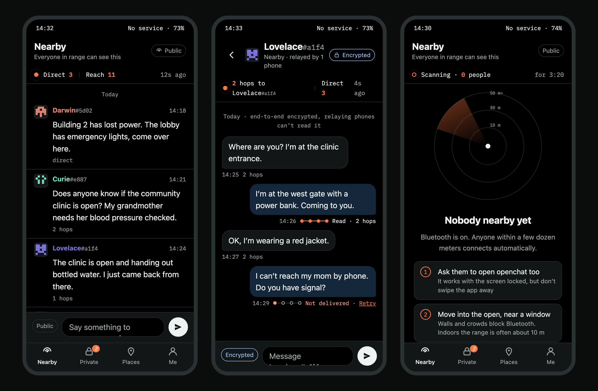
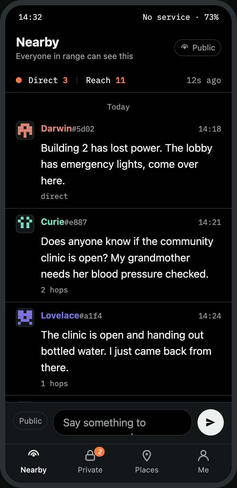
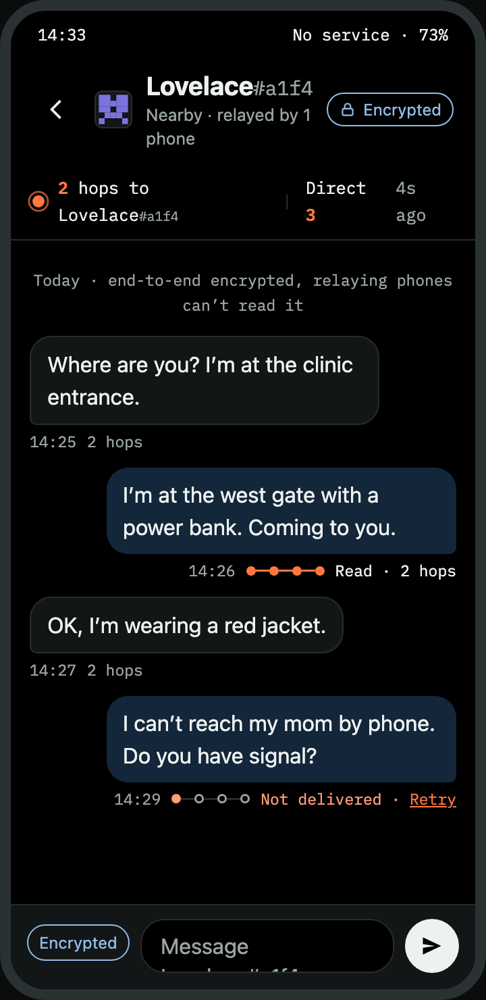
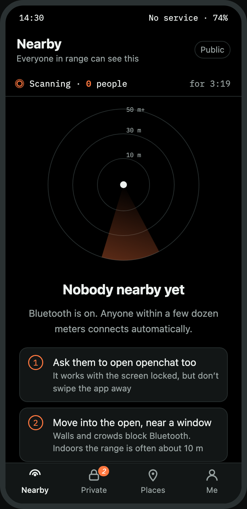

<div align="center">


# openchat

**为停电、灾害和人群密集场合准备的离线优先通讯软件。**
没有网络时走蓝牙 LE mesh，有网络时走 Nostr。
不需要账号、手机号和服务器。

[](LICENSE)
[](https://github.com/wolfqing/openchat/releases)
[](https://github.com/wolfqing/openchat/actions/workflows/android.yml)
[](android/README.md)
[](android/)
[](docs/protocol-spec.md)
[](#现状)

[**下载 APK**](https://github.com/wolfqing/openchat/releases/latest) ·
[协议规范](docs/protocol-spec.md) ·
[变更日志](CHANGELOG.md) ·
[路线图](docs/roadmap.md) ·
[参与贡献](CONTRIBUTING.md) ·
[安全政策](SECURITY.md) ·
[English](README.md)



<sub>定义这个 App 的三个界面：带信号带的「附近」、每条消息都有送达路径的私信、以及附近没人时的雷达。由设计原型渲染，v0.7.0 已实现这些界面。</sub>

</div>

---

## 为什么做这个

网络断了之后，一栋楼、一个体育场、一个街区里的手机仍然可以通过蓝牙互相通信。每部手机都替其他手机转发，消息一跳一跳传到该收到的人那里。这就是 [bitchat](https://github.com/permissionlesstech/bitchat) 协议做的事，它的协议、代码和白皮书全部是公有领域。

openchat 是**同一张网络上的独立客户端，MIT 许可**。它说的是和 bitchat 完全相同的线路协议，没有增加任何东西。它改变的是这个 App 给谁用、长什么样：

- **给没见过 IRC 的人用。** 断网时装 mesh 通讯软件的人不是终端用户。手机离线状态下，从安装到发出第一条消息三步完成，这是及格线。
- **mesh 看得见。** 信号带告诉你能联系到多少部手机。每条消息都显示它经过了几跳。每条私信都有送达路径：已发出、在路上、已送达、已读。附近没人时你看到的是一个雷达和三件可做的事，不是一个空列表。
- **定位于基础设施故障，不是政治。** 地震、台风、运营商故障、音乐节和体育场的基站过载、徒步和航海。它不是翻墙工具，也不会这样宣传。
- **永远协议兼容。** 一部 openchat 手机就是每一部 bitchat 手机的中继，反之亦然。与上游的互操作是发布门槛，不是功能。

## 现状

| | 状态 |
|---|---|
| Android 应用 | **v0.7.0 预览版。** 174 个单元测试，APK 9.1 MB，18 种语言。改动见 [CHANGELOG.md](CHANGELOG.md) |
| 与原版 bitchat 互通 | **尚未验证。** 按[规范](docs/protocol-spec.md)、上游测试向量和从 bitchat 构建中录得的信封实现；与原版 bitchat 客户端的互通验证是下一个里程碑 |
| 安全审计 | **没有。** 线路上的一切都是上游的；上游做过一次审计（Cure53，2025-11），仍有未关闭的发现 |
| 发布签名 | v0.6.0 起使用专用发布密钥签名，证书指纹在 [SECURITY.md](SECURITY.md)。v0.5.0 及之前的预览版是调试密钥签名，须先卸载 |
| iOS | 未开始 |

不要在「被识别身份会有严重后果」的场合依赖 openchat。App 首次启动时会这样提示。详见 [SECURITY.md](SECURITY.md)。

## 能做什么

下面每一项都是 bitchat 的线路格式。openchat 唯一增加的是本机的东西：怎么把 mesh 画在屏幕上。

### 完全没有网络时

- **附近。** 一个带签名的公开频道，蓝牙范围内所有人可读，逐跳转发。长消息自动分片重组。
- **私信**，Noise XX 端到端加密，有送达和已读回执。转发的手机读不到内容。
- **私密群组**，最多 16 人。创建者在每次变动时签署成员名单和新密钥；消息用群密钥封装、由作者签名，像公开消息一样洪泛转发，但只有成员能读。目前仅支持文字。
- **公告板。** 发一条公告，保留 1、3 或 7 天，可标为紧急，可随时撤下。公告在手机之间传递，也通过历史同步传播，两天后才到的人也能看到。
- **存储转发。** 发给不在范围内的人的消息被封装后交给最多三部附近的手机代为携带，直到遇见收件人。每部手机发布八把一次性预密钥，所以被携带的消息具有前向保密：事后偷到手机也解不开途中截获的消息。
- **历史同步。** 后加入的人从邻居那里拿到最近 15 分钟的公开消息，以及公告和预密钥。
- **照片和语音**，公开或私发。**实时语音**：按住麦克风说话，别人在你说的同时就能听到。
- **当面验证**，用二维码加 Noise 挑战；以及**担保**：你验证过的人会告诉你的手机他们验证过谁，这些人的名片上会出现一个灰色对勾。
- `/ping` 和 `/trace` 显示到某人的往返时间、跳数和估算路径。想用的人有 IRC 风格命令：`/msg /who /block /fav /group /pay /drop /help` 等。
- **洪泛保护**，与 bitchat 一致：一个发送者可以一次发五条，之后每秒一条；同一段文字可以同时出现三次，之后每两秒一次。超出的隐藏，但仍然转发。

### 有网络时

- **位置频道**，基于 Nostr，按 geohash 划分，每个格子一个匿名密钥，用一个地球仪选区域：拖动、捏合、点击。与 bitchat 用同一批中继，所以房间是共享的。位置便签 24 小时后消失。
- **mesh 桥接**，默认关闭。打开后，「附近」的消息也通过你所在街区格子（约 1.2 公里）的中继传递，使用不可关联的格子密钥，让同一区域内的两个蓝牙孤岛互相听见。有网络的桥接手机还会服务周围没网络的手机：它们在位置频道发的内容经它发出，发给不在范围内的人的消息也作为密封投递件停放在中继上。
- **互相收藏的人之间通过 Nostr 私信**，使用 bitchat 的信封格式，在蓝牙够不到时使用。
- **默认走 Tor，失败即关闭。** 中继流量经过 Tor；Tor 不可用时不会有任何明文流量发出。位置频道消息带一点工作量证明，让活跃的发送者能越过按发送者的限流。
- `/pay` 发送 Cashu 电子现金代币；消息里的代币显示为一张卡片，带金额、铸币方、备注和「在钱包中打开」按钮。App 从不与铸币方通信。

### 安全与日常

- **没有账号、手机号和邮箱。** 密钥在首次启动时生成。默认昵称是 `anon`；每个名字都带一个由密钥派生的 `#xxxx` 后缀，重名的人不会被混淆。
- **连点三下左上角的 logo**，擦除一切并换一个新身份。没有确认对话框，这是刻意的。「我」标签页里还有一个带确认的「清空所有数据」按钮，给无法快速连点三下的人。擦除会把旧密钥清零、让 Tor 换上新的入口节点重启，并丢弃仍以旧身份排队的一切。
- **默认安静。** 通知只显示「新消息」，没有名字、地点和正文，除非你打开预览；锁屏上无论如何都是安静的。收到的照片在点开前显示为粗糙色块。
- **离线分享 App。** 通过蓝牙或快传把 APK 发给身边的手机。不需要应用商店，而应用商店打不开的时候这一点很重要。
- 熄屏后继续转发。无线电按扫描占空比工作，三分之二的时间在休眠。可以在 mesh 上和每个位置频道里屏蔽人。支持 @提及。支持读屏软件。
- **18 种语言**，包括从右到左的阿拉伯语和波斯语。机器初译，欢迎母语者校对。

完整的功能与文件对照、测试套件说明见 [android/README.md](android/README.md)。

## 截图

<table>
<tr>
<td align="center"><br><sub><b>附近。</b>直连 3，可达 11。每个发送者有一个由密钥画出的徽记，每条消息都写着它走了多远。</sub></td>
<td align="center"><br><sub><b>私信。</b>每条消息四个点：已发出、在路上、已送达、已读。始终没送到的消息变红并可重发。</sub></td>
<td align="center"><br><sub><b>附近没人。</b>断网时最常见的状态，所以给它一个真正的页面：一个雷达和三件有用的事。</sub></td>
</tr>
</table>

<sub>由可点击的原型 [docs/design/ui-prototype.html](docs/design/ui-prototype.html) 渲染；设计理由见 [docs/design/ui-direction.md](docs/design/ui-direction.md)。示例昵称都是历史人物。</sub>

## 安装

1. 从[最新发布](https://github.com/wolfqing/openchat/releases/latest)下载 APK。需要 Android 8.0 或更新。如果手机上还装着 v0.5.0 及之前的预览版，先卸载：它们是调试密钥签名的，发布密钥无法覆盖安装。
2. 安装前核对文件，尤其是经手机对手机传来的时候。SHA-256 在发布说明和 [CHANGELOG.md](CHANGELOG.md) 里；签名证书指纹在 [SECURITY.md](SECURITY.md)。

   ```bash
   shasum -a 256 openchat-*.apk
   apksigner verify --print-certs openchat-*.apk
   ```

3. 授予蓝牙和附近设备权限。Android 要求 BLE 扫描带位置权限；mesh 不读取你的位置，只有加入位置频道时才会用到。
4. 打开**我**标签页，点**分享 App**，把安装包传给身边的手机。请在断网*之前*做这件事。

## 与 bitchat 的关系

| | bitchat | openchat |
|---|---|---|
| 线路协议 | bitchat 的 | **完全相同。** 同样的数据包、Noise 握手，以及群组、公告板、桥接、预密钥和 Nostr 格式 |
| 代码 | iOS：公有领域。Android：GPL-3.0 | 用 Kotlin 从零写成。**不含任何 bitchat 源码。** GPL 的 Android 代码从未读过 |
| 许可 | Unlicense / GPL-3.0 | MIT |
| 给谁用 | 刻意的「IRC 风格」 | 没见过 IRC 的人 |
| 看到什么 | 终端风格的聊天 | mesh 本身：信号带、跳数、徽记、送达路径、雷达 |
| 定位 | 通用 | 基础设施故障 |
| 关系 | — | 独立客户端。与 bitchat 项目无关联，未经其背书 |

协议是从公有领域的 iOS 源码整理成 [docs/protocol-spec.md](docs/protocol-spec.md) 的，这份三十节的字节级规范此前并不存在。如果你在做任何需要和 bitchat 通信的东西，这份文档和 [docs/bitchat-protocol-notes.md](docs/bitchat-protocol-notes.md) 本身就可能有用。

## 文档

| 文档 | 内容 |
|---|---|
| [docs/protocol-spec.md](docs/protocol-spec.md) | openchat 实现的线路规范：数据包、转发、Noise 会话、信使、同步、群组、公告板、桥接、预密钥、Cashu、实时语音，以及 mesh 如何显示 |
| [docs/bitchat-protocol-notes.md](docs/bitchat-protocol-notes.md) | 上游协议实际在做什么，带数据、审计历史和未关闭的 issue |
| [docs/phase0-findings.md](docs/phase0-findings.md) | 183 条 App Store 评论和 764 个上游 issue 的分类；项目启动前的 go/no-go |
| [docs/design/ui-direction.md](docs/design/ui-direction.md) | 界面方向：两层、五个元素、为什么让 mesh 看得见 |
| [docs/roadmap.md](docs/roadmap.md) | 阶段、退出条件，以及项目在什么条件下停止 |
| [CHANGELOG.md](CHANGELOG.md) | 每个版本的改动、测试数和 APK 哈希 |
| [SECURITY.md](SECURITY.md) | 如何报告漏洞、范围、发布签名 |
| [CONTRIBUTING.md](CONTRIBUTING.md) | 三条规则、DCO、动手前先问什么 |
| [NOTICE](NOTICE) | 第三方组件和公有领域数据 |

## 从源码构建

需要 JDK 17 和带 platform 36 的 Android SDK。

```bash
cd android
echo "sdk.dir=$HOME/Library/Android/sdk" > local.properties
./gradlew :app:testDebugUnitTest :app:assembleDebug
```

调试版 APK 在 `app/build/outputs/apk/debug/`。发布版用 `assembleRelease` 构建（R8，仅 ARM，约 9 MB），签名密钥从不在仓库里的 `android/keystore.properties` 读取；没有这个文件时回退到调试密钥。CI 在每个 PR 上跑同样的测试和构建。

## 参与贡献

欢迎 issue、互操作报告、翻译和实地笔记。三条规则是硬性的，[CONTRIBUTING.md](CONTRIBUTING.md) 解释了原因：

1. **净室。** 读过 bitchat-android 源码的人不能向这里贡献 Kotlin 代码。MIT 许可建立在这一点上。
2. **互操作是发布门槛。** 任何破坏与原版 bitchat 手机兼容的改动都不会发布。
3. **定位不可协商。** 不做翻墙功能和宣传，不宣称未经审计的安全性。

提交需要按 [Developer Certificate of Origin](https://developercertificate.org/) 签字。没有 CLA。

## 路线图一句话

先做 Android，从零开始、对照规范：已做到 v0.7.0。接下来是与原版 bitchat 手机做互通验证，然后 iOS，然后在一次防灾演练或一个人群密集场所做一次真实试点。每个阶段的退出条件和终止条件在 [docs/roadmap.md](docs/roadmap.md)。

## 名字

「openchat」是临时名，和 GitHub 上几个无关的 LLM 项目重名。正式名待定，改名后仓库会自动重定向。

## 许可证

本仓库全部内容采用 MIT，见 [LICENSE](LICENSE)。不含任何上游代码。App 内置的第三方库和公有领域数据列在 [NOTICE](NOTICE)。

## 致谢

建立在 bitchat 贡献者的工作之上，他们把协议放进公有领域的决定让独立客户端成为可能。与他们无关联，未经其背书。地球仪里的海岸线、边界和城市位置来自 Natural Earth，同样是公有领域。

<div align="center">
<sub>如果你觉得「普通人在断网时也能用的 mesh 通讯软件」值得存在，一个 ⭐ 能帮更多人找到它。</sub>
</div>
