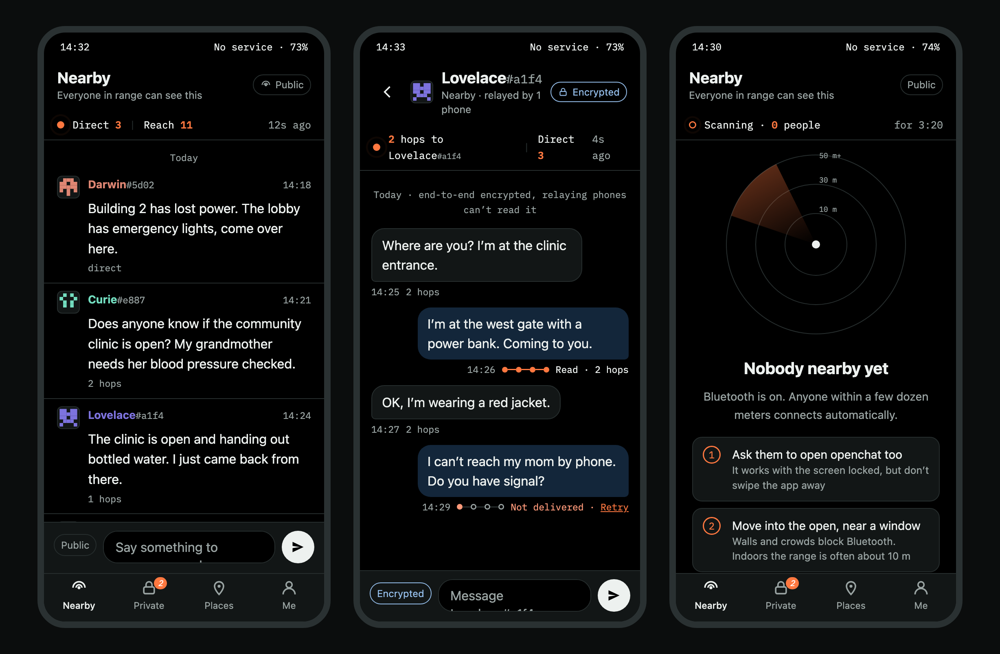
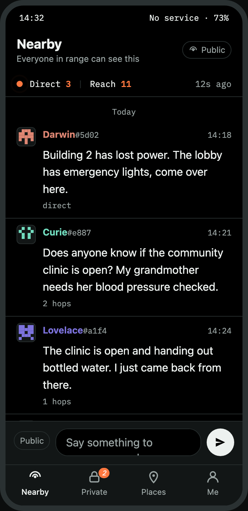
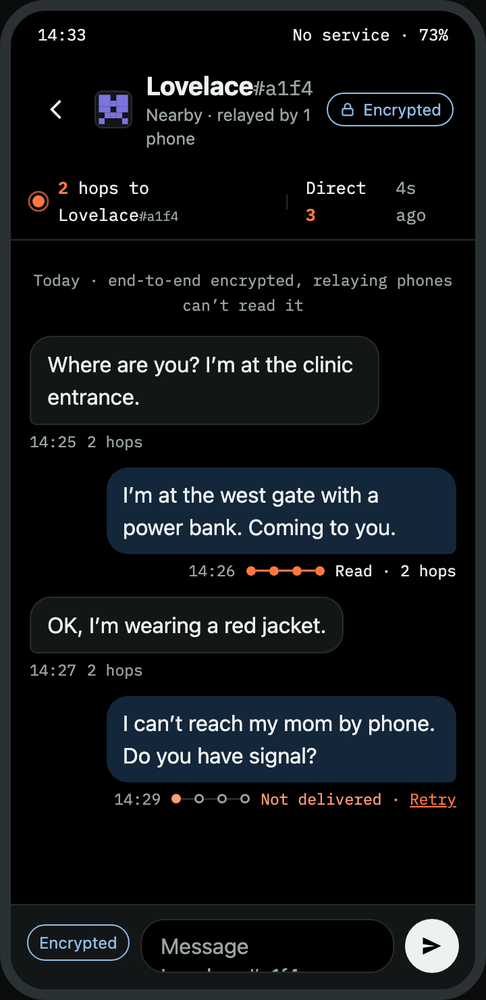
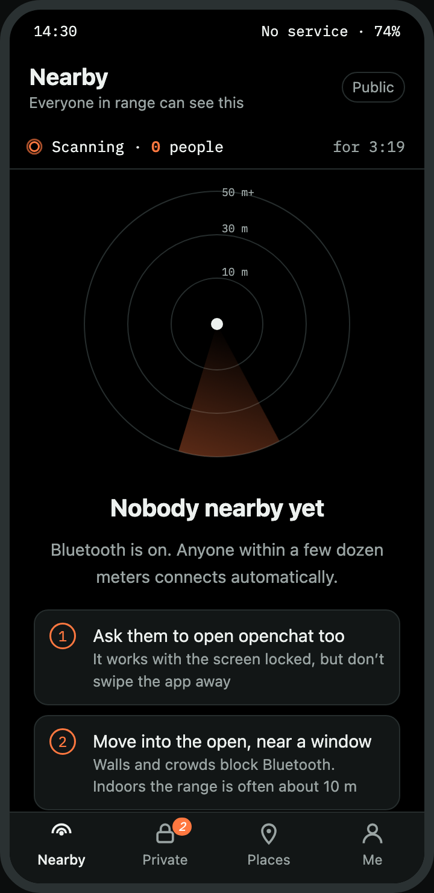

<div align="center">


# openchat

**为停电、灾害和人群密集场合准备的离线优先通讯软件。**
没有网络时走蓝牙 LE mesh，有网络时走 Nostr。
不需要账号、手机号和服务器。

[](LICENSE)
[](https://github.com/wolfqing/openchat/releases)
[](https://github.com/wolfqing/openchat/actions/workflows/android.yml)
[](android/README.md)
[](android/)
[](docs/protocol-spec.md)
[](#现状如实说)

[**下载 APK**](https://github.com/wolfqing/openchat/releases/latest) ·
[协议规范](docs/protocol-spec.md) ·
[路线图](docs/roadmap.md) ·
[参与贡献](CONTRIBUTING.md) ·
[安全政策](SECURITY.md) ·
[English](README.md)



<sub>暗色主题的设计原型。App 按这个方向实现；第一次真机测试后会换成真机截图。</sub>

</div>

---

## 为什么做这个

网络断了之后，一栋楼、一个体育场、一个街区里的手机仍然可以通过蓝牙互相通信。每部手机都替其他手机转发，消息一跳一跳传到该收到的人那里。这就是 [bitchat](https://github.com/permissionlesstech/bitchat) 协议做的事，它的协议、代码和白皮书全部是公有领域。

openchat 是**同一张网络上的独立客户端，MIT 许可**，带着三个不同的出发点：

- **给没见过 IRC 的人用。** 断网时装 mesh 通讯软件的人不是终端用户。手机离线状态下，从安装到发出第一条消息三步完成，这是及格线。mesh 本身被做成看得见的：信号带、每条消息的送达路径、跳数、身份徽记，以及一个专门设计的「附近还没有人」页面，而不是一个空列表。
- **定位于基础设施故障，不是政治。** 地震、台风、运营商故障、音乐节和体育场的基站过载、徒步和航海。它不是翻墙工具，也不会这样宣传。
- **永远协议兼容。** 一部 openchat 手机必须能给每一部 bitchat 手机做中继，反之亦然。与上游的互操作是发布门槛，不是功能。

## 现状，如实说

| | 状态 |
|---|---|
| Android 应用 | **v0.5.0 预览版。** 可构建，94 个单元测试通过，APK 9.5 MB，18 种语言 |
| 真机测试 | **还没有。** 至今每个版本都没有在硬件上跑过 |
| 与原版 bitchat 互通 | **尚未验证。** 按规范和上游测试向量实现，还没有和真实的 bitchat 手机交换过数据包 |
| 安全审计 | **没有。** 线路上的一切都是上游的；上游做过一次审计（Cure53，2025-11），仍有未关闭的发现 |
| iOS | 未开始 |
| 发布签名 | 预览版用调试密钥签名。安装前核对发布说明里的 SHA-256 |

不要在「被识别身份会有严重后果」的场合依赖 openchat。App 首次启动时会这样提示。详见 [SECURITY.md](SECURITY.md)。

## 能做什么

**在 mesh 上，完全没有网络时**

- 蓝牙 LE mesh：每部手机同时是外设和中心设备，按[线路规范](docs/protocol-spec.md)做多跳转发、去重、TTL 和分片。
- 一个带签名的公开**附近**频道，范围内所有人可读。
- **私信**用 Noise XX 端到端加密，有送达和已读回执。转发的手机读不到内容。
- **存储转发**：发件箱加上由附近手机代为携带的信使信封，发送时不在范围内的人也能收到。
- **历史同步**：后加入的人从邻居那里拿到最近 15 分钟的公开消息。
- **照片和语音**，公开或 Noise 加密私发。
- 用 bitchat 的 `bitchat://verify` 二维码加 Noise 挑战做**当面验证**。
- 每个昵称都带一个由 peer ID 派生的 `#xxxx` 后缀，重名的人不会被混淆。

**有网络时**

- 基于 Nostr 的**位置频道**，按 geohash 划分，每个格子一个匿名密钥。与 bitchat 用同一批中继，所以房间是共享的。
- 互相收藏的人之间可以通过 Nostr 私信，使用 bitchat 的信封格式。
- 中继流量**默认走 Tor，失败即关闭**。

**安全与日常**

- 没有账号、手机号和邮箱。密钥在首次启动时生成。
- **连按三下标题**，擦除一切并换一个新身份。没有确认对话框，这是刻意的。
- **离线分享 App**：通过蓝牙或快传把 APK 发给身边的手机。不需要应用商店，而应用商店打不开的时候这一点很重要。
- 熄屏后继续转发。可以屏蔽人。支持 @提及。给想用的人保留了 IRC 风格的斜杠命令。
- 18 种语言，包括从右到左的阿拉伯语和波斯语。机器初译，欢迎母语者校对。

完整的功能与文件对照见 [android/README.md](android/README.md)。

## 截图

<table>
<tr>
<td align="center"><br><sub>附近：直连 3、可达 11，每条消息都显示跳数</sub></td>
<td align="center"><br><sub>私信：每条消息有送达路径，失败变红并可重发</sub></td>
<td align="center"><br><sub>附近没人：最常见的状态，所以给它一个真正的页面</sub></td>
</tr>
</table>

<sub>来自可点击的原型 [docs/design/ui-prototype.html](docs/design/ui-prototype.html)；设计理由见 [docs/design/ui-direction.md](docs/design/ui-direction.md)。示例昵称都是历史人物。</sub>

## 安装

1. 从[最新发布](https://github.com/wolfqing/openchat/releases/latest)下载 APK。需要 Android 8.0 或更新。
2. 安装前核对发布说明里的哈希，尤其是文件经手机对手机传来的时候：

   ```bash
   shasum -a 256 openchat-*.apk
   ```

3. 授予蓝牙和附近设备权限。Android 要求 BLE 扫描带位置权限；openchat 的 mesh 不读取你的位置。
4. 打开**我**标签页，点**分享 App**，把安装包传给身边的手机。请在断网*之前*做这件事。

## 与 bitchat 的关系

| | bitchat | openchat |
|---|---|---|
| 线路协议 | bitchat 的 | **完全相同。** 同样的数据包、同样的 Noise 握手、同样的 Nostr 信封 |
| 代码 | iOS：公有领域。Android：GPL-3.0 | 用 Kotlin 从零写成。**不含任何 bitchat 源码。** GPL 的 Android 代码从未读过 |
| 许可 | Unlicense / GPL-3.0 | MIT |
| 给谁用 | 刻意的「IRC 风格」 | 没见过 IRC 的人 |
| 定位 | 通用 | 基础设施故障 |
| 关系 | — | 独立客户端。与 bitchat 项目无关联，未经其背书 |

协议是从公有领域的 iOS 源码反向整理成 [docs/protocol-spec.md](docs/protocol-spec.md) 的，这份字节级规范此前并不存在。如果你在做任何需要和 bitchat 通信的东西，这份文档和 [docs/bitchat-protocol-notes.md](docs/bitchat-protocol-notes.md) 本身就可能有用。

## 文档

| 文档 | 内容 |
|---|---|
| [docs/protocol-spec.md](docs/protocol-spec.md) | openchat 实现的字节级线路规范：头部、TLV、Noise XX、信使信封、同步、Nostr 嵌入 |
| [docs/bitchat-protocol-notes.md](docs/bitchat-protocol-notes.md) | 上游协议实际在做什么，带数据、审计历史和未关闭的 issue |
| [docs/phase0-findings.md](docs/phase0-findings.md) | 183 条 App Store 评论和 764 个上游 issue 的分类；项目启动前的 go/no-go |
| [docs/design/ui-direction.md](docs/design/ui-direction.md) | 界面方向：两层、五个元素、为什么让 mesh 看得见 |
| [docs/roadmap.md](docs/roadmap.md) | 阶段、退出条件，以及项目在什么条件下停止 |
| [CHANGELOG.md](CHANGELOG.md) | 每个版本，带提交号和 APK 哈希 |

## 从源码构建

需要 JDK 17 和带 platform 35 的 Android SDK。

```bash
cd android
echo "sdk.dir=$HOME/Library/Android/sdk" > local.properties
./gradlew :app:testDebugUnitTest :app:assembleDebug
```

调试版 APK 在 `app/build/outputs/apk/debug/`。预览版用 `assembleRelease` 构建（R8，仅 ARM，约 9.5 MB）。

## 参与贡献

欢迎 issue、互操作报告、翻译和实地笔记。三条规则是硬性的，[CONTRIBUTING.md](CONTRIBUTING.md) 解释了原因：

1. **净室。** 读过 bitchat-android 源码的人不能向这里贡献 Kotlin 代码。MIT 许可建立在这一点上。
2. **互操作是发布门槛。** 任何破坏与原版 bitchat 手机兼容的改动都不会发布。
3. **定位不可协商。** 不做翻墙功能和宣传，不宣称未经审计的安全性。

提交需要按 [Developer Certificate of Origin](https://developercertificate.org/) 签字。没有 CLA。

## 路线图一句话

先做 Android，从零开始、对照规范。然后与原版 bitchat 手机做实地互通测试，然后 iOS，然后在一次防灾演练或一个人群密集场所做一次真实试点。每个阶段的退出条件和终止条件在 [docs/roadmap.md](docs/roadmap.md)。

## 名字

「openchat」是临时名，和 GitHub 上几个无关的 LLM 项目重名。正式名待定，改名后仓库会自动重定向。

## 许可证

本仓库全部内容采用 MIT，见 [LICENSE](LICENSE)。不含任何上游代码。第三方组件及其许可列在 [NOTICE](NOTICE)。

## 致谢

建立在 bitchat 贡献者的工作之上，他们把协议放进公有领域的决定让独立客户端成为可能。与他们无关联，未经其背书。

<div align="center">
<sub>如果你觉得「普通人在断网时也能用的 mesh 通讯软件」值得存在，一个 ⭐ 能帮更多人找到它。</sub>
</div>
